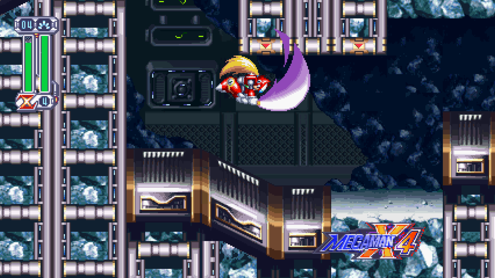
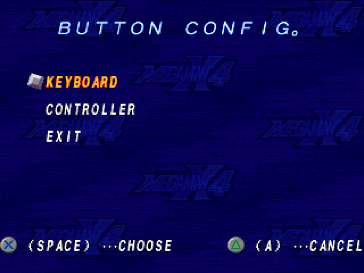
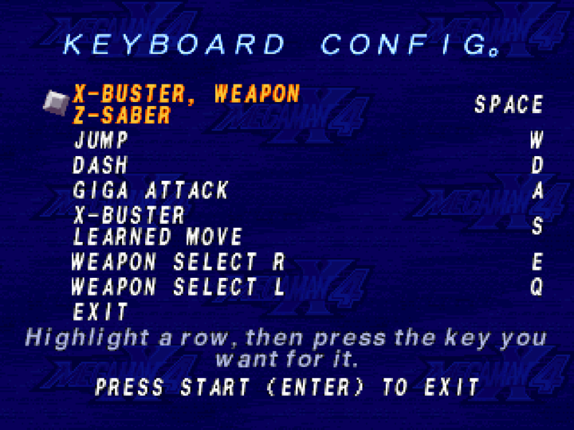
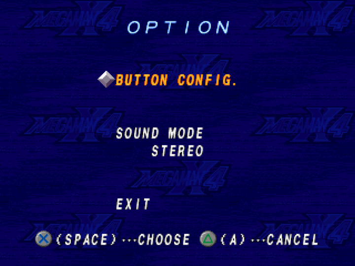
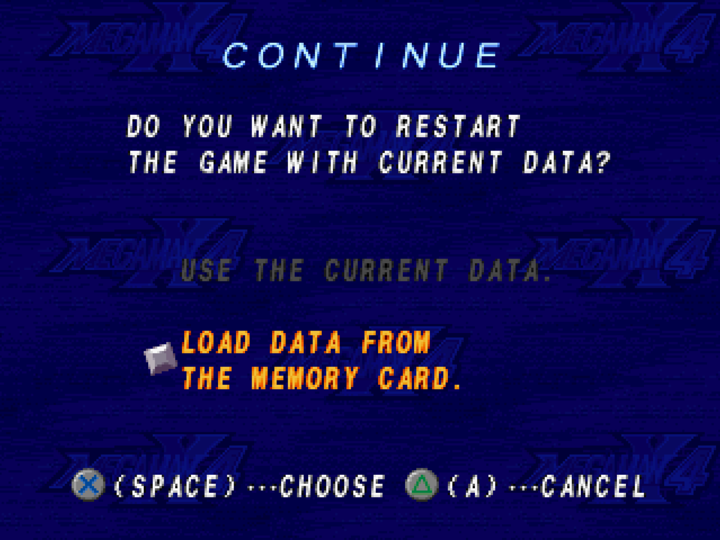

# Mega Man on Mac

**Mega Man X4, recompiled to run natively on Apple Silicon Macs.** No emulator: download the
app, point it at your own disc image, and play with a keyboard or a controller.

<p align="center">
  
</p>

<p align="center"><b><a href="https://github.com/MaiRajborirug/MegaManOnMac/releases/latest">⬇ Download the latest .dmg</a></b> · macOS 11+ · Apple Silicon (M1 or newer)</p>

## Where this comes from

This is a fork of [**mstan/MegaManX4Recomp**](https://github.com/mstan/MegaManX4Recomp), the
Mega Man X4 recompilation for Windows and Linux. Thank you to mstan and everyone who built and
playtested it. For two-player X + Zero co-op, netplay and the full set of mods, go to the
[original project](https://github.com/mstan/MegaManX4Recomp).

It runs on [PSXRecomp](https://github.com/RetroPortingToolKit/psxrecomp) and
[recomp-ui](https://github.com/RetroPortingToolKit/recomp-ui); this repo uses my forks of both
([psxrecomp](https://github.com/MaiRajborirug/psxrecomp),
[recomp-ui](https://github.com/MaiRajborirug/recomp-ui)).

## What this fork adds

- **A Mac app.** One `.dmg` for Apple Silicon with everything bundled. Drag it to Applications.
- **Change your keys inside the game.** OPTION → BUTTON CONFIG opens a Controls page in X4's
  own style. Pick Keyboard or Controller, highlight an action, press the new key or button.
- **Prompts that name your keys.** Capcom's `✕ ···CHOOSE  △ ···CANCEL` shows the key you
  actually press, e.g. `✕ (SPACE) ···CHOOSE`.

<p align="center">
  
  
  <br>
  
  
</p>

## Install and play

**You need**

1. A Mac with Apple Silicon (M1 or newer).
2. The app: `MegaManX4Recomp-<version>-macos-arm64.dmg` from
   [Releases](https://github.com/MaiRajborirug/MegaManOnMac/releases/latest).
3. Your own **Mega Man X4 (USA, SLUS-00561)** disc image: a `.cue` + `.bin` pair. The game is
   not included. Only the original, unmodified USA disc listed in [DISC.md](DISC.md) is
   accepted. If your image is a `.zip`, double-click it and Finder unzips it.

**Install (once)**

1. Open the `.dmg` and drag **Mega Man X4 Recompiled** onto **Applications**.
2. The app is not signed by Apple, so macOS blocks it the first time. Open Terminal and run:

   ```sh
   xattr -dr com.apple.quarantine "/Applications/Mega Man X4 Recompiled.app"
   ```

**Play**

1. Open **Mega Man X4 Recompiled** from Applications.
2. Click the **Disc** row and choose your `.cue` (or the `.bin` if you have no `.cue`). Keep the
   two files together, with their original names, somewhere permanent such as Documents.
3. The launcher checks the disc; **Play** turns on when it is the original USA disc.
4. Press **Play**. The disc is remembered, so next time you only press Play.

**Default keyboard**

| Action | Key | | Action | Key |
| --- | --- | --- | --- | --- |
| Move | Arrow keys | | Giga attack | R |
| Shoot / Z-Saber | Z | | Special move | A |
| Jump | X | | Weapon left / right | Q / W |
| Dash | S | | Start / pause | Return |

Change any of them in **OPTION → BUTTON CONFIG**. Controllers work too. **Ctrl+L** (or
fn+F10) opens the settings menu.

Saves, settings and key bindings live in `~/Library/Application Support/MegaManX4Recomp`, so
installing a newer `.dmg` keeps them.

## Build it yourself

```sh
brew install cmake ninja sdl3 python dylibbundler
git clone --recurse-submodules https://github.com/MaiRajborirug/MegaManOnMac.git
cd MegaManOnMac
```

Generate code from your disc as in [DEVELOPMENT.md](docs/DEVELOPMENT.md), then build and
package with the commands at the top of [tools/package_macos.sh](tools/package_macos.sh)
(keep Homebrew, not conda, first on `PATH`). The `.dmg` lands in `release-macos/`.

Intel Macs are not built or tested (they need an x86_64 SDL3).

---

Original project code is [MIT licensed](LICENSE). Dependencies keep their own
[licenses and notices](THIRD_PARTY_NOTICES.md). Mega Man X4 and its imagery belong to Capcom.
You supply the game disc; this is an unofficial project.
